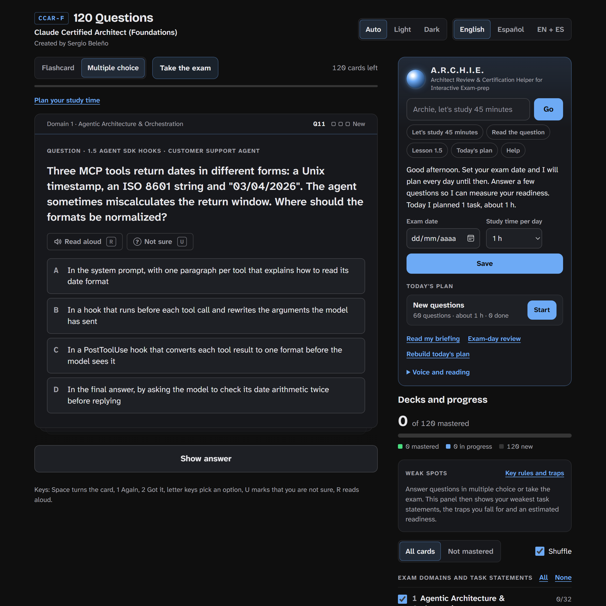

# Claude Certified Architect (Foundations) - Flashcards

**Practice for the Claude Certified Architect (Foundations) exam with
flashcards, multiple-choice drills, and a timed 60-question exam
simulation, all in one self-contained HTML page, in English and Spanish.**

<p>
  
  
  
  
  
</p>




There's nothing to install or build. Open `docs/index.html` in a browser
and start studying.

> **Unofficial study aid.** This project isn't affiliated with or endorsed
> by Anthropic. Every question was written for this page from the public
> exam guide, and none is a real exam item. The estimated exam score is a
> guide, not a prediction.

## Contents

- [Features](#features)
- [Getting started](#getting-started)
- [How it works](#how-it-works)
- [Question bank](#question-bank)
- [Study modes](#study-modes)
- [Exam simulation](#exam-simulation)
- [A.R.C.H.I.E.](#archie)
- [Weak spots](#weak-spots)
- [Traps and key rules](#traps-and-key-rules)
- [Study timer](#study-timer)
- [Progress and storage](#progress-and-storage)
- [Keyboard shortcuts](#keyboard-shortcuts)
- [Editing the question bank](#editing-the-question-bank)
- [Study advice](#study-advice)
- [Credits](#credits)

## Features

| Feature | What it does |
|---|---|
| Flashcards | Answer in your head, turn the card, then grade yourself **Again** or **Got it** |
| Multiple choice | Pick an option and get an explanation for the right answer and every wrong one |
| Exam simulation | 60 questions drawn from the 120 in the exam's proportions, 120 minutes, grouped by scenario, no feedback until you submit, estimated score out of 1,000 |
| Scenarios | Every question is set in one of the 6 exam scenarios, shown before the question as on the exam |
| Mastery tracking | Every card moves through New → Learning → Familiar → Mastered |
| Weak spots | Accuracy per task statement, an estimated readiness score, and one-click sessions for your weakest areas |
| Not sure | Mark a guess before you answer; a lucky right answer still counts as weak |
| Traps | Every wrong option is tagged with one of 12 distractor patterns, and the page tracks which ones catch you |
| Key rules | A last-minute review sheet: one rule per task statement (30) plus the trap guide |
| A.R.C.H.I.E. | A study assistant: a daily plan to your exam date, commands such as "let's study 45 minutes", questions read aloud, lessons |
| Decks | One deck per task statement (30), grouped under the 5 exam domains |
| Diagrams | 60 inline SVG diagrams explain the answers to questions 1–60, and you can enlarge them |
| Study timer | Plan a session (120 minutes by default) with optional Pomodoro breaks and an estimate of how many cards fit |
| Languages | English, Spanish, or both side by side (`EN + ES`) |
| Themes | Auto (follows the system), Light, or Dark |
| Sync | Saves to the browser, or to your Claude account when the page runs as a Claude Artifact |

## Getting started

```bash
git clone https://github.com/sergiotechlead/Claude-Certified-Architect-Foundations-Flashcards.git
cd Claude-Certified-Architect-Foundations-Flashcards
start "" "docs/index.html"     # Windows
open "docs/index.html"         # macOS
xdg-open "docs/index.html"     # Linux
```

You can also double-click the file. It works offline, apart from the
Google Fonts stylesheet. Without it, the page falls back to system fonts.

### Optional local server

If you'd rather serve the page over HTTP, there's an optional Node.js
setup:

```bash
npm install
npm start          # serves docs/ at http://localhost:3000
```

Because the page lives in `docs/`, you can also publish it with GitHub
Pages (**Settings → Pages → Deploy from a branch → `main` / `docs`**).

## How it works

```text
docs/index.html
 ├── <style>                          layout, light/dark tokens, reduced-motion rules
 ├── markup                           header, study area, decks panel, dialogs
 ├── <script type="application/json" id="bank">   the question bank (data only)
 └── <script>                         app logic: decks, grading, exam, timer, storage, i18n
```

- **One file, no build step.** All CSS, JavaScript, data, and diagrams are
  inline. The only external request is for fonts.
- **Data and code are separate.** The question bank is a JSON block that
  the script parses at load time, so you can edit questions without
  touching the logic.
- **Every string is bilingual.** Interface text lives in the `T.en` and
  `T.es` tables. Bank entries store text as `["English", "Español"]` pairs.

## Question bank

The bank holds **120 questions**, twice the length of the real exam. The
exam guide (version 1.0) weights the 5 domains and lists 30 task
statements without weights, so each domain's count is rounded from its
weight. Every task statement has twice its exam share, so each one has at
least two questions and each exam attempt can draw a fresh set.

| # | Domain | Weight | Task statements | Bank | Per exam |
|---|---|---|---|---|---|
| 1 | Agentic Architecture & Orchestration | 27% | 7 | 32 | 16 |
| 2 | Tool Design & MCP Integration | 18% | 5 | 22 | 11 |
| 3 | Claude Code Configuration & Workflows | 20% | 6 | 24 | 12 |
| 4 | Prompt Engineering & Structured Output | 20% | 6 | 24 | 12 |
| 5 | Context Management & Reliability | 15% | 6 | 18 | 9 |
| | **Total** | **100%** | **30** | **120** | **60** |

Each question is set in one of the six exam scenarios. The real exam
presents four of them.

| Scenario | Questions |
|---|---|
| Customer support agent | 22 |
| Code generation with Claude Code | 25 |
| Multi-agent research | 21 |
| Developer productivity | 20 |
| Claude Code in CI | 14 |
| Structured data extraction | 18 |

Ten questions ask for two answers, as the exam's multiple-response items
do. Every question was written for this page from the public exam guide;
none is a real exam item. Questions 61–120 have no diagram, and their
answers are explained in text.

## Study modes

- **Flashcard.** Read the question, answer in your head, and turn the card.
  Grade yourself **Got it** to move the card up one level, or **Again** to
  send it back to *Learning*. A missed card comes back within the next few
  cards.
- **Multiple choice** (the default). Choose an option (or two, when the
  card says so) and press **Check**. The card explains why the right
  answer is right and why each other option falls short.

In the **Decks and progress** panel you can choose domains and task
statements, show only cards you haven't mastered, and turn shuffle on or
off. When you finish a deck, you can restudy only the cards you missed.

In multiple choice, press **Not sure** (or `U`) before you answer when
you're guessing. A right answer marked this way counts as half, so the
question stays on your weak-spot list until you answer it with confidence.
After you answer, every wrong option shows the trap it belongs to.

## Exam simulation

**Take the exam** opens a timed run that's as close to the real exam as the
page can make it:

1. **60 questions drawn from the 120, grouped by scenario.** Each attempt
   draws a fixed number of questions per task statement (the quota in the
   bank), so every exam keeps the guide's proportions with a new set of
   questions. The scenarios come in a random order, and the questions
   inside each one are shuffled. Each question shows its scenario first, as
   the exam does.
2. **120 minutes in one block, with no breaks.** The clock starts when you
   confirm, and it can't be paused. You can hide the clock, but it keeps
   running.
3. **Multiple choice only, with no feedback while you answer.** You can go
   back, change answers, flag questions to review, and strike out options
   you've ruled out.
4. **Decks, flashcards, and the timer are locked** until you submit. The
   exam doesn't change your study progress.
5. **When the time runs out, the exam is submitted for you.** Unanswered
   questions count as wrong.

The result shows how many you got right, a breakdown by domain, the
questions you missed, and an estimated score:

```text
estimated score = 100 + 900 × (correct ÷ 60)        pass mark: 720
```

The official exam reports a scaled score, and its conversion isn't
published. Treat the estimate as a guide only. Past attempts are listed in
the decks panel, and you can clear them without losing study progress.

Every exam answer also feeds the weak-spots panel. A question you flagged
and got right counts as a guess.

## A.R.C.H.I.E.

**A.R.C.H.I.E.** (*Architect Review & Certification Helper for Interactive
Exam-prep*) is a study assistant built into the page. It runs entirely in
the browser, so it works on GitHub Pages and offline, with no server, no
API key and no microphone. You type to it, it reads to you, and you pick
the answers on screen.

**Commands.** Type in the box at the top of the panel, or tap a
suggestion:

| You type | A.R.C.H.I.E. does |
|---|---|
| `Archie, let's study 45 minutes` | Starts the study timer with Pomodoro breaks and queues as many questions as fit, starting with today's plan |
| `an hour and a half`, `1h30`, `2 pomodoros`, `estudiemos media hora` | Understands times in English and Spanish, in digits or words |
| `let's study` (no time) or anything it doesn't understand | Starts a **30-minute** session and says so |
| `read the question` | Reads the scenario, question and options |
| `stop` / `para`, `stop the timer` | Stops reading, or ends the timer |
| `lesson 1.5` | Opens the lesson for that task statement |
| `key rules`, `traps`, `exam`, `today's plan`, `help` | Reads the rules aloud, opens the trap guide, opens the exam, reads your briefing, lists commands |

**Daily plan.** Set your exam date and daily study time, and A.R.C.H.I.E.
plans each day:

- a full exam simulation on scheduled days: a baseline, then every four
  days, and two days before the exam;
- questions split between what you missed or guessed, your weakest task
  statements, and new questions, paced so you see all 120 before the exam;
- the key rules read aloud in the last three days, a light review the day
  before, and an exam-day checklist on the day.

Each task shows its progress and starts with one click. The plan is fixed
for the day; **Rebuild today's plan** recomputes it.

**Reading aloud.** **Read aloud** on every card (or `R`) reads the
question and options. After you answer, it reads the verdict, the correct
answer and why. In the exam it reads only the question.

**Voice.** The panel always shows the voice in use, with a **Change
voice** link. The menu lists every voice on your device, male voices
first, and you can pick any of them for each reading language, even an
English voice for Spanish text. The choice is saved. By default A.R.C.H.I.E.
is a **US-English man** (and a US-Spanish man in Spanish). Browsers don't
report a voice's gender, so it finds male voices by name, for example
*Microsoft Guy* or *David* on Windows and *Alex* on a Mac. If your device
has no male voice for a language, the panel says so, uses the best voice
available, and explains how to add voices. Under **Voice and reading** you
can also turn on automatic reading of every card and change the speed.

**Lessons and exam day.** A lesson gathers one task statement's key
rule, what its questions teach and the traps that appear there, then lets
you practice those questions. **Exam-day review** has a five-point
checklist and your top traps, and can read them aloud.

Speech uses the browser's built-in Web Speech API, available in Chrome,
Edge, Safari and Firefox. Where it isn't available, A.R.C.H.I.E. works in
text only.

## Weak spots

The **Weak spots** panel in the decks column collects every answer you
give: in multiple choice, in flashcards (your own grade) and in the exam.
For each question it keeps your last three results: right and sure, right
but unsure, or wrong. From that it shows:

- **Estimated readiness.** The same 100–1,000 scale as the exam, with
  every question you haven't answered yet counted as a guess (25%):

  ```text
  readiness = 100 + 900 × Σ (quota of task statement ÷ 60) × average(score of its questions)
  score = share of the last 3 answers that were right (an unsure right answer counts as half)
  ```

  Each task statement weighs what it weighs in the exam, however many
  questions it has in the bank.

  Questions you've already seen are easier to remember, so treat it as a
  ceiling, not a forecast.
- **Weakest task statements.** Up to five task statements under 85%,
  weakest first.
- **One-click sessions.** *Study these* (every card in those task
  statements), *Missed or unsure* (questions whose last answer wasn't a
  confident right one) and *Not practiced yet*.
- **Traps you fall for.** The three distractor patterns that have caught
  you most, with a tip for spotting each one.

## Traps and key rules

Wrong options in scenario questions tend to follow a few patterns. Every
wrong option in the bank is tagged with one of twelve:

| Trap | What it looks like |
|---|---|
| Asks the prompt for a guarantee | Stronger wording or "be careful" where code, a hook or a schema must enforce it |
| Tunes the wrong thing | temperature, max_tokens, a bigger window or a timeout that doesn't touch the cause |
| Invented behavior | A feature described as working in a way it doesn't |
| Wrong tool, file or scope | Glob vs Grep, PreToolUse vs PostToolUse, user vs project scope |
| Wrong-sized pattern | Too heavy (classifier, custom server) or too light (direct edits for a big migration) |
| More context, less focus | Pasting everything, every tool for every agent, one prompt over many files |
| Patches around the problem | Resends, blind retries, best of N, a regex tuned to today's wording |
| Hides the gap or invents data | Fake success, generic errors, averaged figures, forced values |
| Throws out what works | Removing a tool, a category or a source for everyone |
| Trusts an unreliable signal | Self-reported confidence, sentiment, averages, the typical case |
| Pushes the job onto people | Asking customers to repeat facts or developers to remember a step |
| Does not answer the question | A true statement that answers something else |

**Key rules and traps** (link at the top of the panel) opens a review
sheet with:

- **Key rules.** One rule per task statement (30), grouped by domain. Weak
  task statements are marked, and you can show only those. Read it the
  night before and the morning of the exam.
- **Traps.** The twelve patterns, how to spot each one, and how often each
  one has caught you.

## Study timer

**Plan your study time** sets a session of 30 min, 1 h, 2 h, or any length
from 5 to 600 minutes. It defaults to 120 minutes, the length of the exam.

- **Pomodoro breaks** are off by default. Turn them on for 25 minutes of
  focus, then a 5-minute break, with an optional chime.
- **Card estimate.** The page assumes about one minute per card at first,
  then adjusts to your own pace (idle time is ignored).
- **Breaks** open a full-screen rest prompt with a breathing guide. You
  can skip the break or end the timer.

## Progress and storage

| Key (`localStorage`) | Holds |
|---|---|
| `ccarf:progress:v1` | Each card's level and when you last graded it |
| `ccarf:settings:v1` | Theme, language, mode, filters, and your measured pace |
| `ccarf:timer:v1` | The running study timer, so it survives a reload |
| `ccarf:exam:v1` | An exam in progress, so it survives a reload |
| `ccarf:attempts:v1` | Your past exam attempts and their scores |
| `ccarf:answers:v1` | Weak-spot stats: the last 3 results per question and how often each trap caught you |
| `ccarf:archie:v1` | A.R.C.H.I.E.: exam date, daily time, voice settings, today's plan and what you answered today |

When the page is published as a **Claude Artifact**, it also saves progress
to your Claude account through `window.claude` and merges it with the
browser's copy, keeping the newest grade for each card. If the account
isn't available, the page keeps working from the browser's copy. The
weak-spot stats stay in the browser only.

**Reset progress** erases the levels and the weak-spot stats for every
card. The levels are erased in the account too.

## Keyboard shortcuts

| Context | Key | Action |
|---|---|---|
| Study | `Space` | Turn the card |
| Study | `1` | Again |
| Study | `2` | Got it |
| Study / Exam | `A`, `B`, `C`… | Pick an option |
| Multiple choice | `U` | Mark that you're not sure |
| Study / Exam | `R` | Read the card aloud (again to stop) |
| Exam | `Shift` + `A`, `B`, `C`… | Strike out an option |
| Exam | `←` `→` | Previous / next question |
| Exam | `F` | Flag the question |
| Dialogs | `Esc` | Close |

## Editing the question bank

The bank is the `<script type="application/json" id="bank">` block in
`docs/index.html`. Its top-level keys:

| Key | Contents |
|---|---|
| `domains` | `d`, `name` `[en, es]`, `w` (exam weight) |
| `objectives` | Task statements: `k`, `n` (number such as `1.1`), `d` (domain), `name` `[en, es]`, `rule` `[en, es]` (the key rule) |
| `scenarios` | `k`, `name` `[en, es]`, `desc` `[en, es]` (the setting shown before each question) |
| `cards` | `id`, `n`, `d`, `ob` (task statement), `sc` (scenario), `q` `[en, es]`, `o` (options as `[en, es]` pairs), `a` (correct option indexes), `x` and `w` (explanations), `tr` (one trap key per option, `null` for correct ones), `fixed` (keep option order), `dia` (diagram), `src` |
| `traps` | `k`, `name` `[en, es]`, `desc` `[en, es]`, `spot` `[en, es]` (how to recognize it) |
| `dias` | Inline SVG diagrams, keyed by the id that a card's `dia` names |
| `exam` | `minutes`, `pass`, `tips`, and `quota` (questions drawn per task statement) |
| `defaults` | The starting study mode and timer settings |
| `params`, `code` | API-parameter and code walk-through cards (empty in this build) |

After an edit:

- **Keep the quota in step with the bank.** The `exam.quota` values must
  add up to the exam length (60), and each task statement needs at least
  as many questions as its quota. Without a quota, the exam uses every
  question in the bank.
- **Give each card a scenario.** The exam groups questions by `sc`, and
  the card shows the scenario above the question.
- **Write both languages.** Every text field needs an English and a
  Spanish entry.
- **Use `a` with two indexes for "choose two" questions.** The card and
  the exam rules pick this up on their own.
- **Tag every wrong option.** `tr` needs one entry per option: a key from
  `traps` for each wrong option and `null` for each correct one.
- **Give every task statement a `rule`.** The key-rules sheet lists them.
- **Check the JSON.** A syntax error stops the whole page from loading, so
  open it in a browser and watch the console.

## Study advice

From a candidate who passed: start with the official Anthropic courses
and their hands-on exercises with the Claude API, then practice the
question format with mock exams. The real scenarios are longer than the
ones here and take more reading.

## Credits

Created by **Sergio Beleño**. An unofficial study aid for the Claude
Certified Architect (Foundations) exam.
